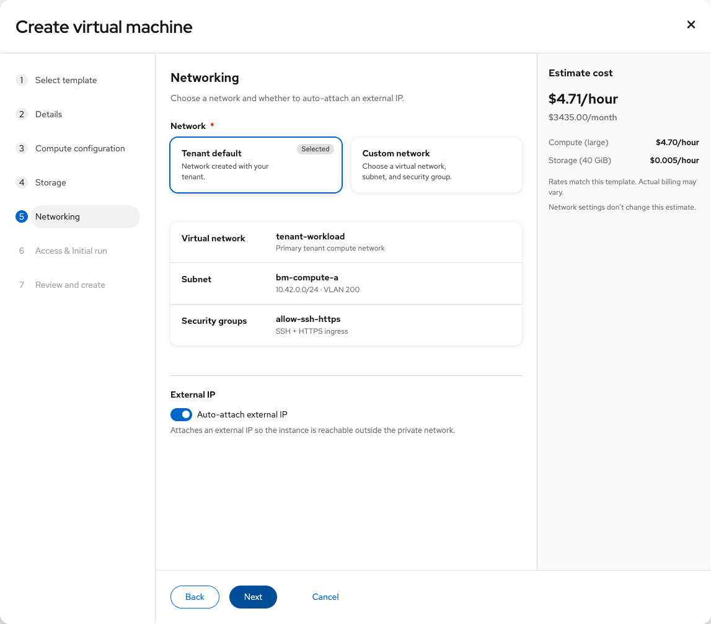
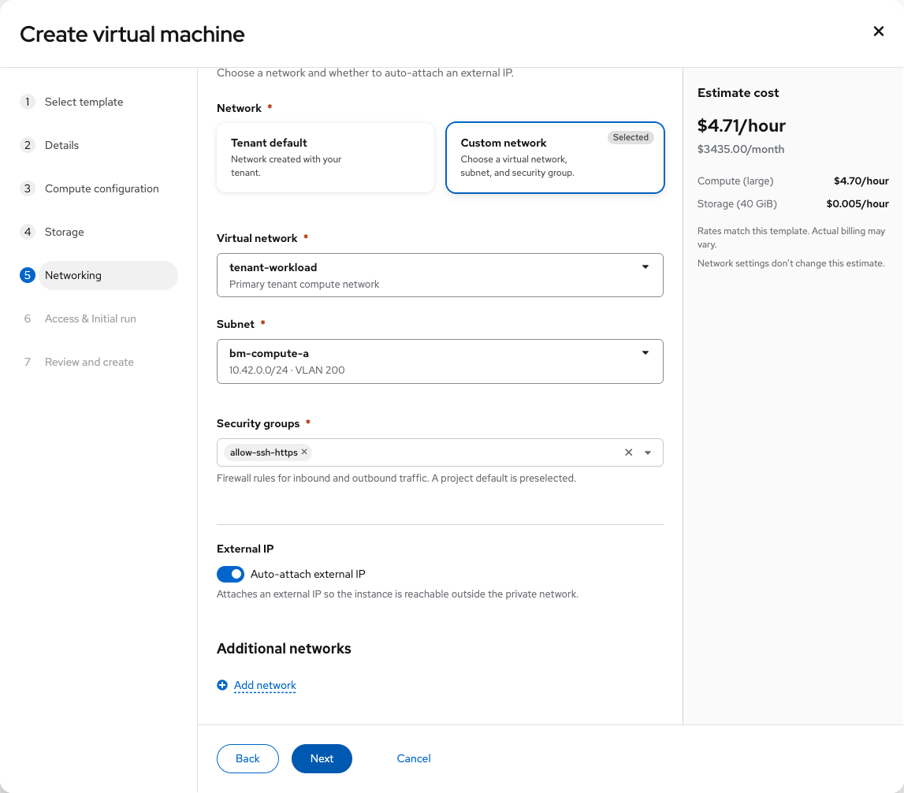
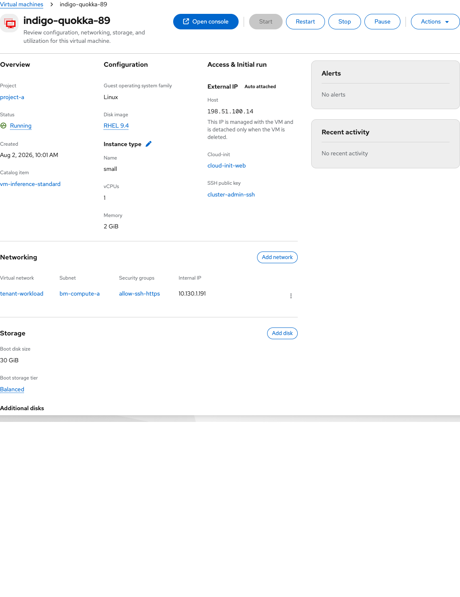
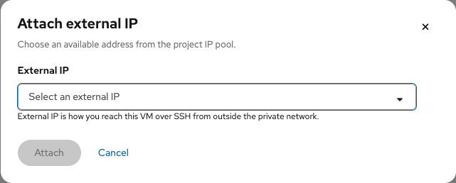

# Tenant Networking

Contact: Yifat Friman Menchik, UXD

Current design: 4 November 2026

| | |
|---|---|
| **Jira** | [OSAC-2621](https://redhat.atlassian.net/browse/OSAC-2621) |
| **Parent epic** | [OSAC-5652](https://redhat.atlassian.net/browse/OSAC-5652) |
| **Feature** | [OSAC-1435](https://redhat.atlassian.net/browse/OSAC-1435) |
| **Scope** | Create VM network attachment and VM Overview External IP |
| **Role** | Tenant Admin; Tenant User where allowed |
| **Interactive mock** | [Current Tenant Networking mockup](https://yfrimanm.github.io/openshift-origin-design/vmaas-ux-prototype.html?v=02966da&role=admin) |
| **Handoff Google Doc** | [Tenant Networking UX document](https://docs.google.com/document/d/1Bb-TzaXkhdASe6btymwRk2u0wXycwyqS-I8h637hDGY/edit) |
| **MD handoff** | [osac-2621-vmaas-tenant-networking-handoff.md](https://github.com/yfrimanm/openshift-origin-design/blob/vmaas-create-vm-wizard/osac-2621-vmaas-tenant-networking-handoff.md) |

This handoff covers how a VM attaches to shared virtual networks during create and how its External IP appears and is managed on VM Overview. Virtual network management and the External IP inventory have separate handoffs.

## Create VM Networking

The Networking step offers Tenant default and Custom network. Tenant default summarizes virtual network, subnet, and security groups. Auto-attach external IP is on by default in the shown template.

Custom network lets the user choose a virtual network, subnet, and security groups. Additional networks are available only on this path; the auto-attach external IP control remains visible.

## External IP on VM Overview

External IP is the first item in Access & Initial run, above Cloud-init and SSH public key. It uses a heading aligned with other Overview subsection headings; no SSH command appears. An auto-attached address has an Auto attached label and explanation. It cannot be edited or detached separately: it is released only when the VM is deleted.

When no address is attached, Attach external IP is a secondary button, aligned with the manual Detach action. The attach modal selects an available address from the project IP pool. Attaching and failed states provide progress or retry/choose-another feedback; the auto-attached state does not expose those manual controls.

This handoff does not own Virtual networks list/create/detail, External IP inventory, or subnet/security-group administration.
