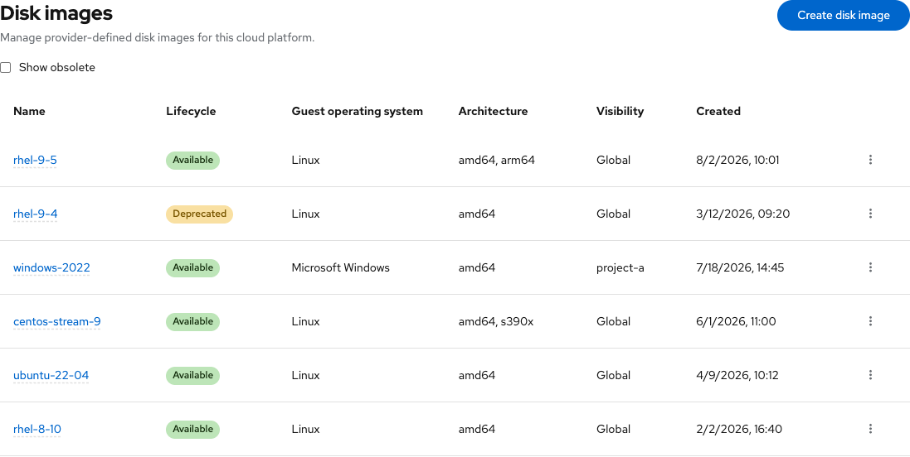
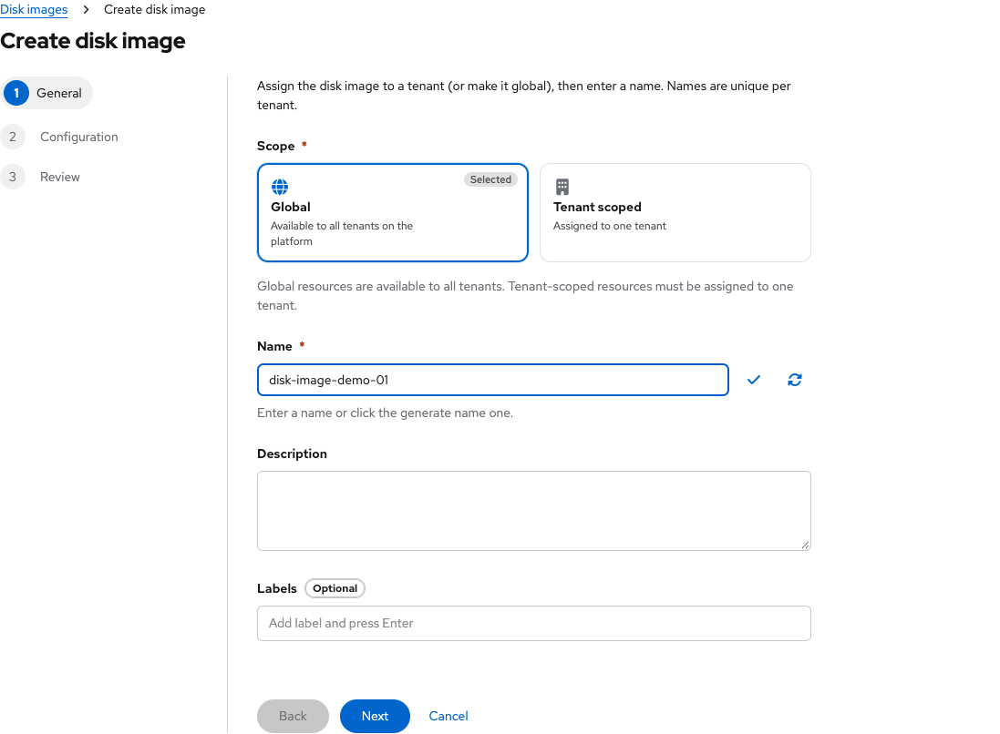
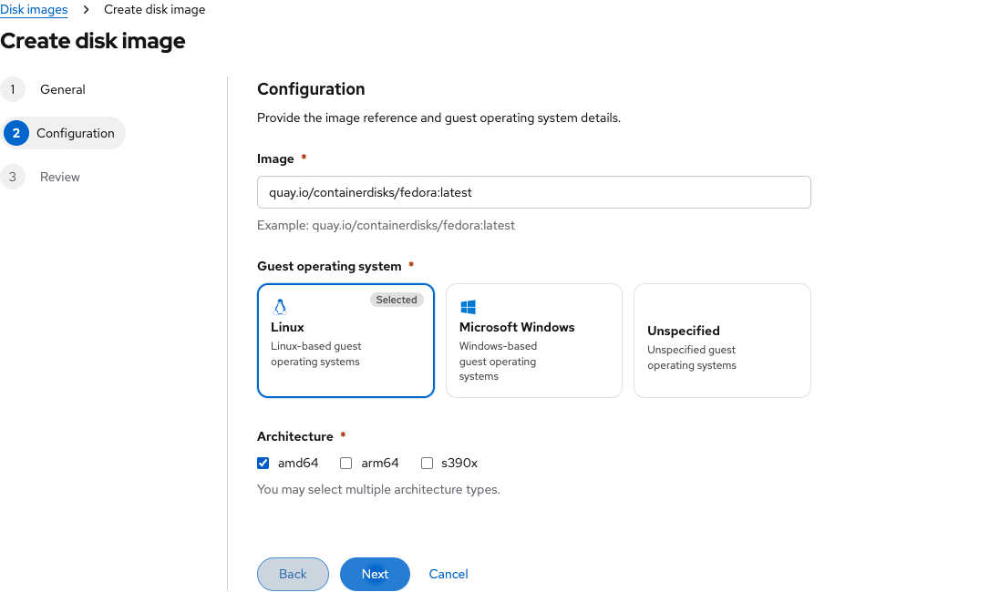
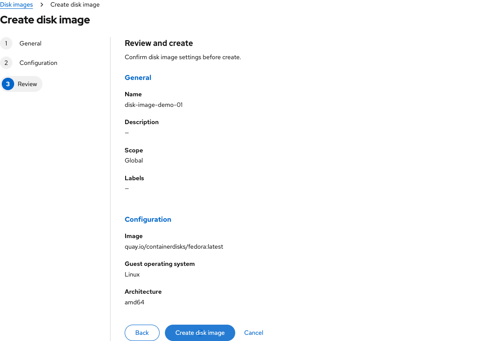
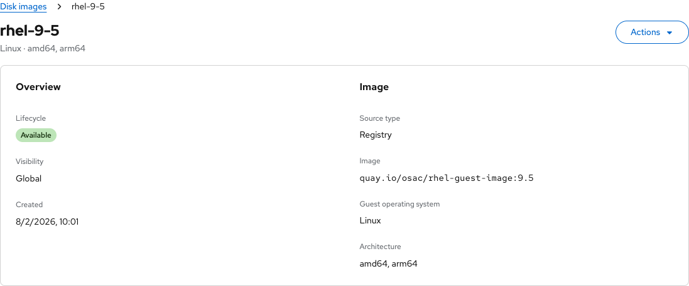

# Disk images

Contact: Yifat Friman Menchik, UXD

Current design: 4 November 2026

| | |
|---|---|
| **Jira** | [OSAC-2810](https://redhat.atlassian.net/browse/OSAC-2810) |
| **Parent epic** | [OSAC-2807](https://redhat.atlassian.net/browse/OSAC-2807) |
| **Feature** | [OSAC-2540](https://redhat.atlassian.net/browse/OSAC-2540) |
| **Scope** | Provider Disk images list, create, detail, and lifecycle |
| **Role** | Cloud provider admin |
| **Interactive mock** | [Current Disk images mockup](https://yfrimanm.github.io/openshift-origin-design/vmaas-ux-prototype.html?v=02966da&role=provider) |
| **Handoff Google Doc** | [Disk images UX document](https://docs.google.com/document/d/1tKrg2Wb2bmD6ny6Iqw87ysnMRwHjj6XmDttc-rv05a4/edit) |
| **MD handoff** | [osac-2810-disk-image-handoff.md](https://github.com/yfrimanm/openshift-origin-design/blob/vmaas-create-vm-wizard/osac-2810-disk-image-handoff.md) |

This handoff documents the Cloud provider admin Disk images experience in the current mockup. Disk images are provider-managed references with metadata, visibility, and lifecycle controls.

## Disk images list

Infrastructure → Disk images opens the provider list. The table shows name, lifecycle, guest operating system, architecture, visibility, creation date, and row actions. Show obsolete is off by default, hiding obsolete images until requested.

## Create disk image

The wizard is General → Configuration → Review and create. In General, choose Global or Tenant scoped, assign a tenant when required, provide a unique DNS-style name, and optionally add description and labels.

Configuration requires an OCI image reference, guest operating system family (Linux, Microsoft Windows, or Unspecified), and at least one architecture. Multiple architecture values are supported.

Review groups General and Configuration before Create disk image. A successful create opens the new image detail page.

## Disk image detail and lifecycle

The detail page separates Overview (lifecycle, visibility, created date) from Image (source type, reference, guest OS, architecture). Available images can be deprecated or made obsolete; deprecated images can be made obsolete or reactivated; obsolete images can be reactivated or deleted. Destructive and transition actions remain conditional on state.

