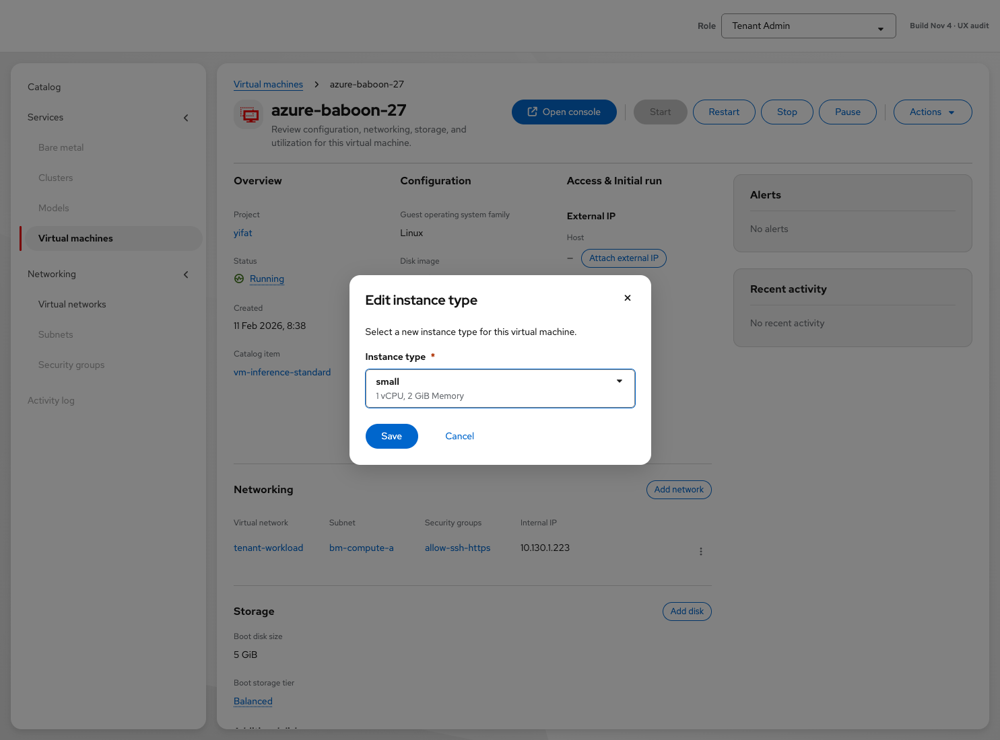
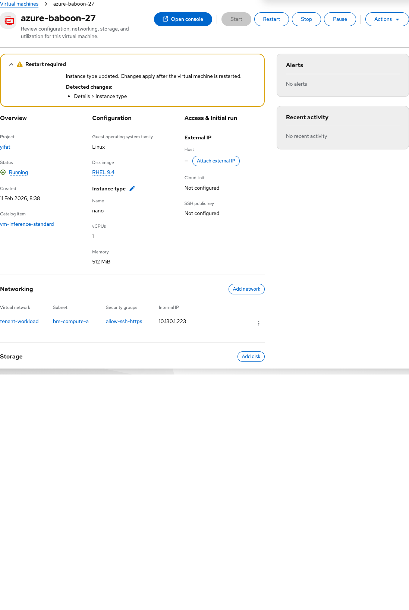

# VM resize via instance type

Contact: Yifat Friman Menchik, UXD

Current design: 4 November 2026

| | |
|---|---|
| **Jira** | [OSAC-4281](https://redhat.atlassian.net/browse/OSAC-4281) |
| **Parent epic** | [OSAC-5635](https://redhat.atlassian.net/browse/OSAC-5635) |
| **Feature** | [OSAC-4277](https://redhat.atlassian.net/browse/OSAC-4277) |
| **Scope** | Day-2 Edit instance type on VM Overview |
| **Role** | Tenant Admin and Tenant User |
| **Interactive mock** | [Current VM resize via instance type mockup](https://yfrimanm.github.io/openshift-origin-design/vmaas-ux-prototype.html?v=02966da&role=admin) |
| **Handoff Google Doc** | [VM resize via instance type UX document](https://docs.google.com/document/d/1kgln_LzTA3-VSP0SUM0jLce2Nvw0pix3oTYkwZuX-wE/edit) |
| **MD handoff** | [osac-4281-vm-resize-handoff.md](https://github.com/yfrimanm/openshift-origin-design/blob/vmaas-create-vm-wizard/osac-4281-vm-resize-handoff.md) |

This handoff defines day-2 instance type changes from VM Overview. The current mockup uses an Edit instance type modal and shows restart requirements only after an update, when the platform reports them.

## Entry and availability

On VM Overview, use the pencil beside Instance type in Configuration. Tenant Admin and Tenant User can resize; unrelated configuration remains role-gated. Editing is available for Running, Paused, and Stopped VMs, and unavailable during transitional states such as Starting, Stopping, or Deleting.

## Edit instance type

The modal presents a required typeahead Instance type selection and Save/Cancel. It does not predict hot-plug or restart from boot-disk access mode before submit. For a Stopped VM, an informational next-start message may be shown. Submit failures stay in the modal as an inline danger alert.

## Feedback after save

Success produces a toast. If the API reports a restart-required condition after a Running or Paused resize, VM Overview shows an expandable Restart required warning with Detected changes. Multiple pending changes can be listed together; the condition clears after the relevant restart or start. A Stopped VM's new size applies on next start.

Do not reintroduce the historical pre-submit hot-plug-versus-restart decision table. The API status condition, not UI inference, is the source of truth for restart need. Backend acceptance of instance-type updates depends on OSAC-5328.
