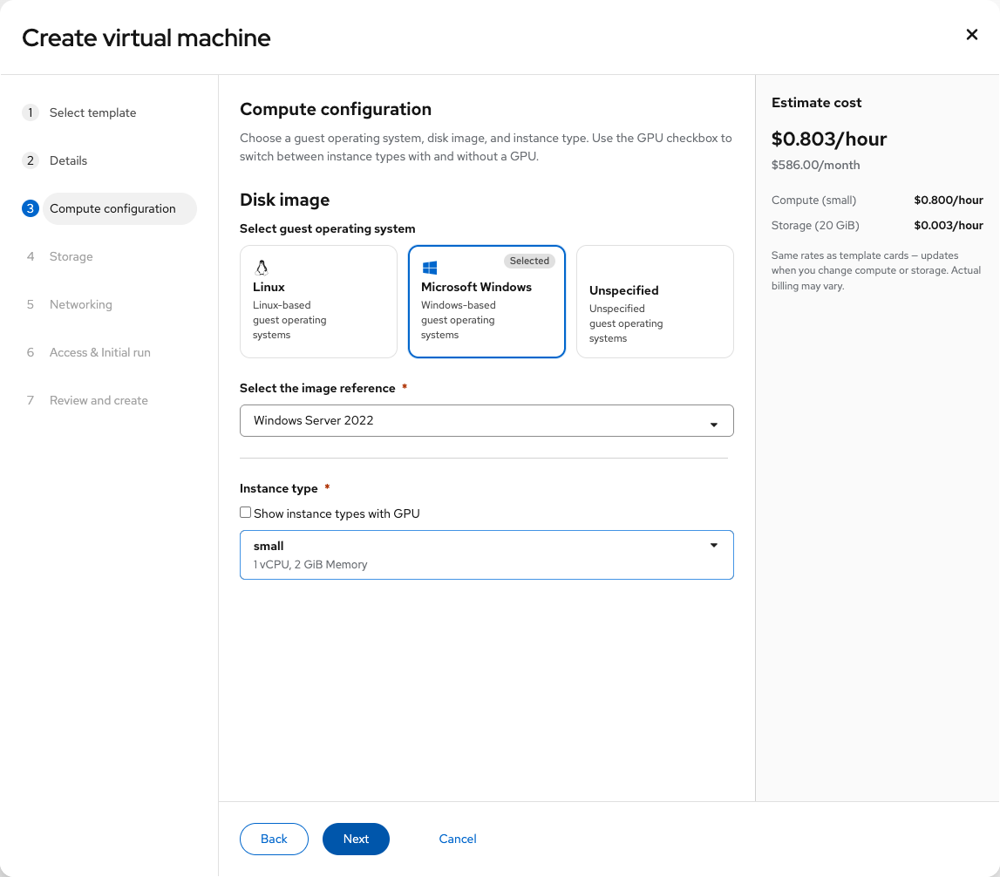
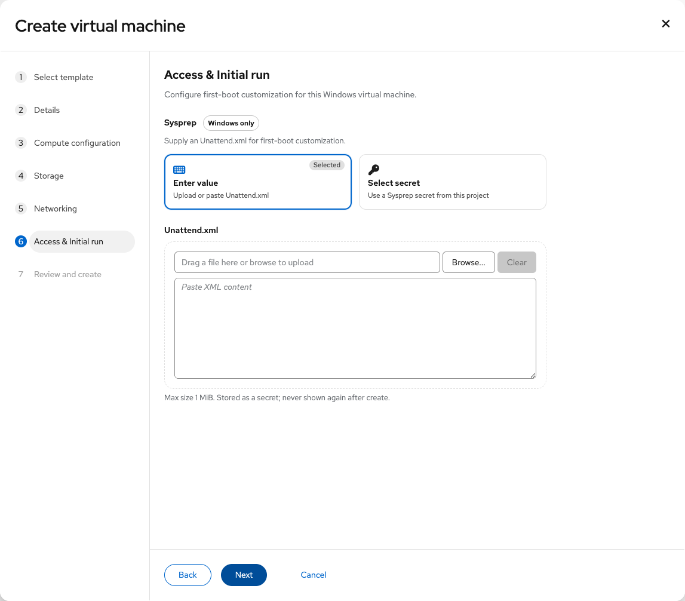
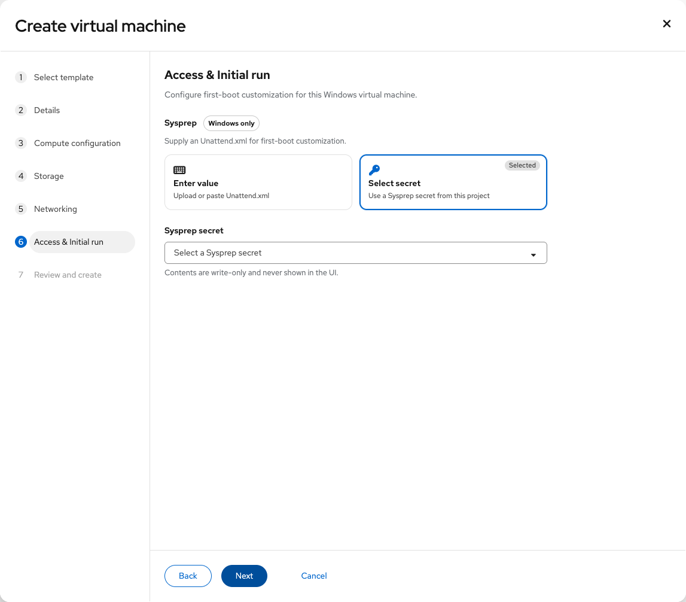

# Create Windows VM with Sysprep

Contact: Yifat Friman Menchik, UXD

Current design: 4 November 2026

| | |
|---|---|
| **Jira** | [OSAC-5009](https://redhat.atlassian.net/browse/OSAC-5009) |
| **Parent epic** | [OSAC-5687](https://redhat.atlassian.net/browse/OSAC-5687) |
| **Feature** | [OSAC-4705](https://redhat.atlassian.net/browse/OSAC-4705) |
| **Scope** | Windows create VM Access and Initial run Sysprep path |
| **Role** | Tenant Admin |
| **Interactive mock** | [Current Create Windows VM with Sysprep mockup](https://yfrimanm.github.io/openshift-origin-design/vmaas-ux-prototype.html?v=02966da&role=admin&create=1) |
| **Handoff Google Doc** | [Create Windows VM with Sysprep UX document](https://docs.google.com/document/d/1NpRGPRKJP-HG769O2Q_7RPagKyfpGTFr_NQkeL1WNWU/edit) |
| **MD handoff** | [osac-5009-windows-sysprep-handoff.md](https://github.com/yfrimanm/openshift-origin-design/blob/vmaas-create-vm-wizard/osac-5009-windows-sysprep-handoff.md) |

This handoff covers optional Windows Unattend.xml input during VM creation. The XML is write-only and used for first-boot Sysprep customization. It is not shown again after creation.

## Select Windows in Compute configuration

The default Create virtual machine flow is template-first. In Compute configuration, choose Microsoft Windows as guest operating system and a Windows disk image. The OS selection is not on Details. The selected family determines which Access & Initial run controls appear.

## Access and initial run

For Windows, the step shows Sysprep with a Windows only label and omits SSH public key and Linux cloud-init. The user may leave Unattend.xml unset to boot without an answer file.

Enter value accepts an upload or pasted Unattend.xml. The UI states a 1 MiB maximum and that content is stored as a secret.

Select secret instead chooses a saved, project-scoped Sysprep secret. Its contents are never displayed in the UI.

## Review

Review shows one Sysprep row: “Provided (hidden)” for entered XML, the selected secret name for a secret, or “Not provided” when unset. It never echoes the XML body or adds a separate method row. The Windows path uses Password / RDP after create as its access method.

This scope is create-time only. Day-2 Sysprep editing and Catalog Provide-default Unattend are separate work.
