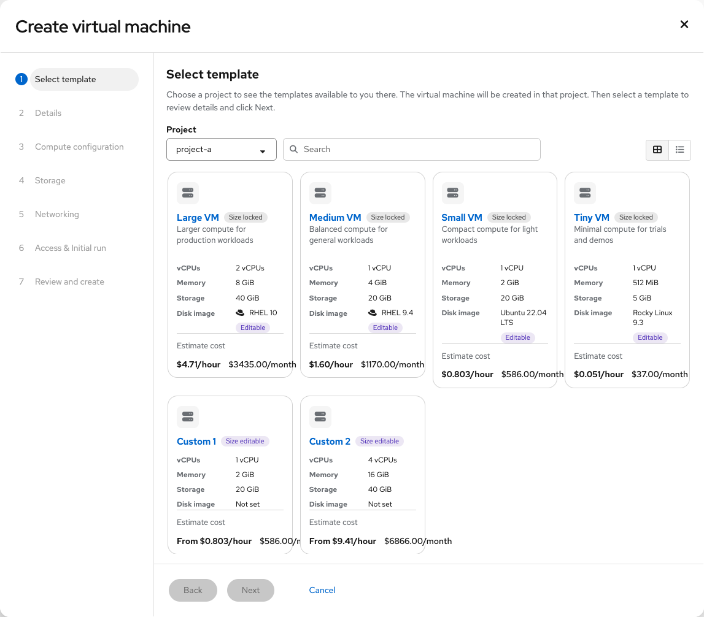
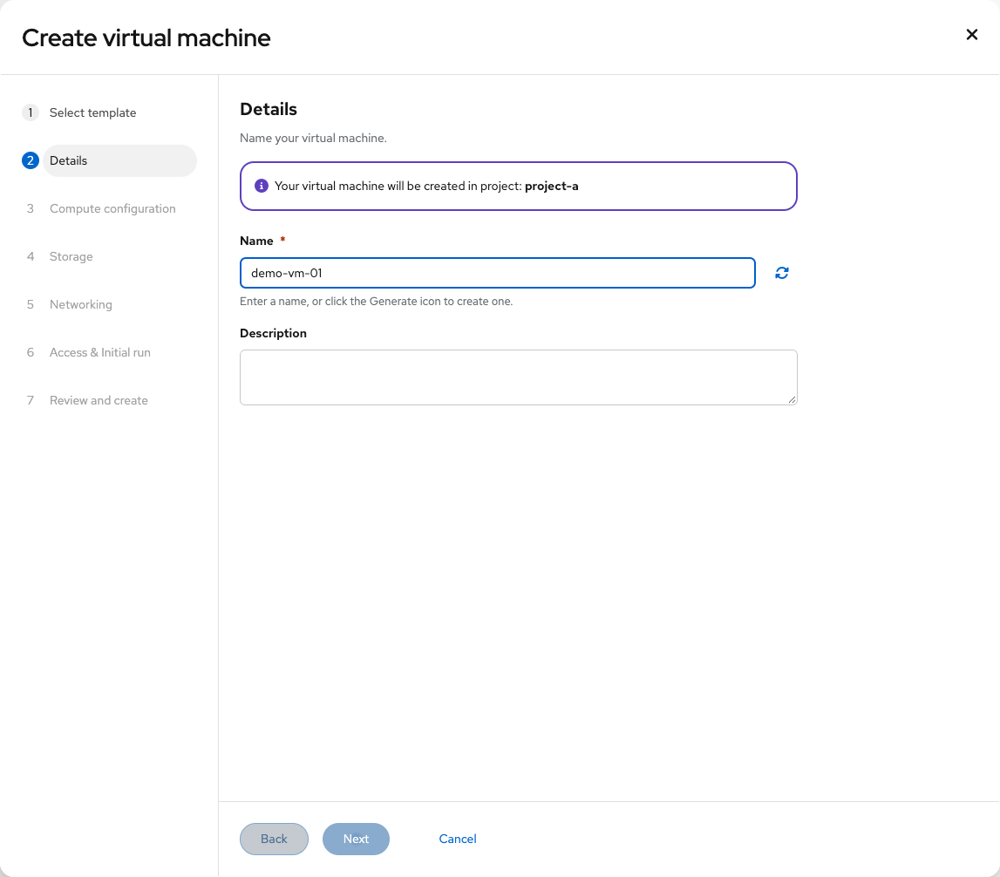
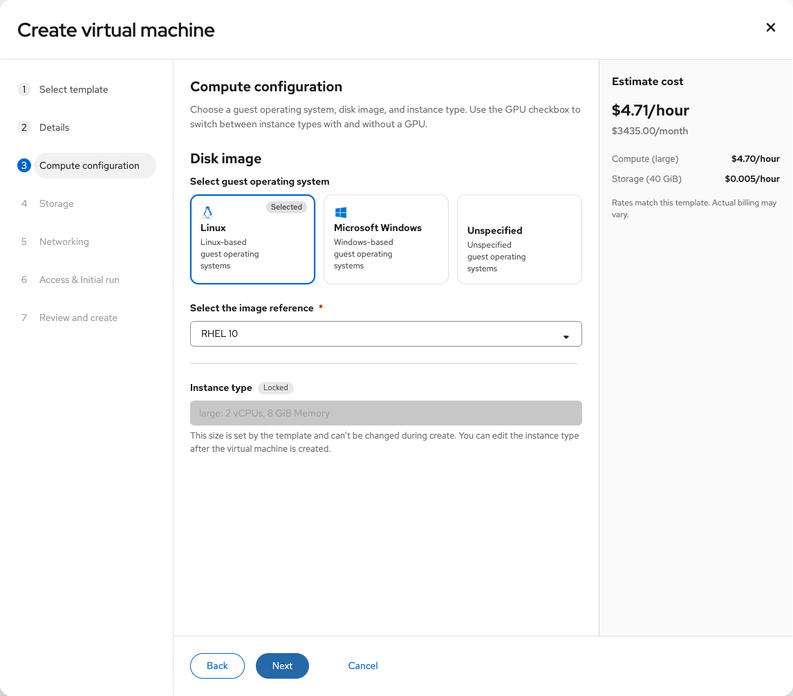
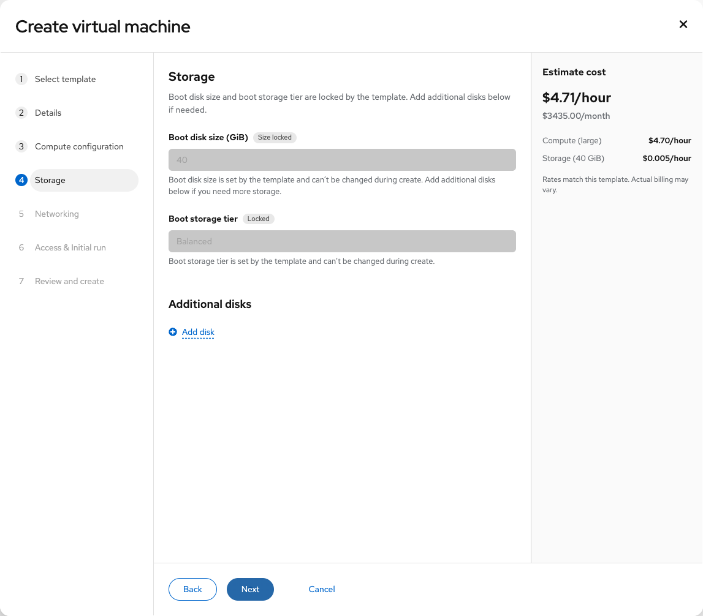
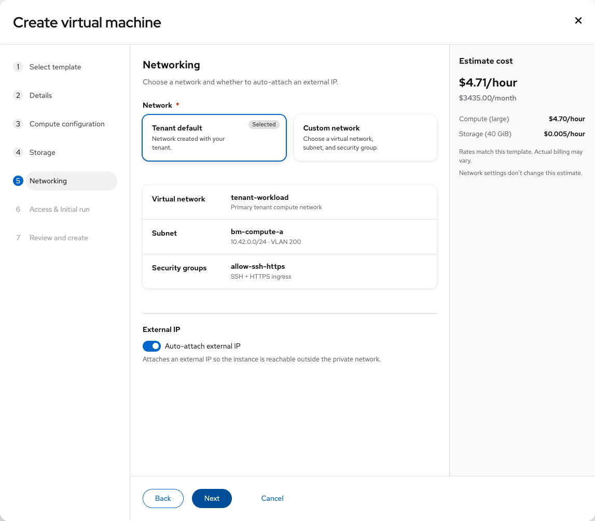
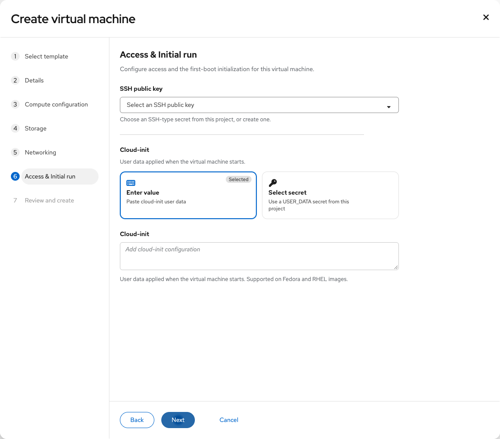
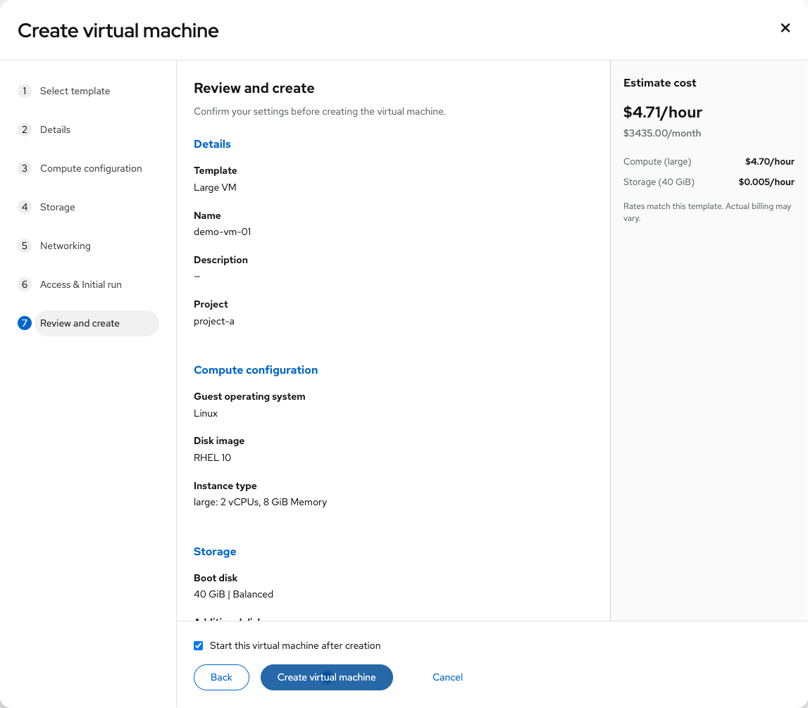
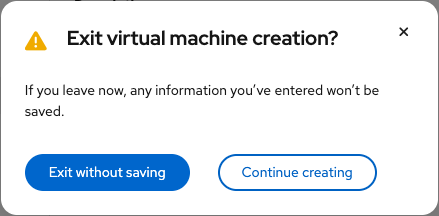

# Create Virtual machine — UX handoff

Contact: Yifat Friman Menchik, UXD
Current design: 4 November 2026

| | |
|---|---|
| **Jira** | [HPUX-2031 — Create a VM flow](https://redhat.atlassian.net/browse/HPUX-2031) |
| **Parent epic** | [HPUX-2031](https://redhat.atlassian.net/browse/HPUX-2031) |
| **Feature** | Template-first Create virtual machine |
| **Scope** | Tenant Admin · default template flow |
| **Role** | Tenant Admin |
| **Interactive mock** | [Create virtual machine mockup](https://yfrimanm.github.io/openshift-origin-design/vmaas-ux-prototype.html?v=0a622a0&role=admin) |
| **Handoff Google Doc** | [Create Virtual machine — UX handoff](https://docs.google.com/document/d/1LL0iWhIIh3gAhJAsm7MCpnlFxfzaOXkZS_MVI6dSfSo/edit) |
| **MD handoff** | [This file](https://github.com/yfrimanm/openshift-origin-design/blob/vmaas-create-vm-wizard/vmaas-create-vm-only-ux-doc.md) |

This handoff covers the default, template-first Create virtual machine flow. Screenshots were captured from the current mockup on 4 November 2026. Custom and clone paths are outside this handoff.

## Flow at a glance

Select template → Details → Compute configuration → Storage → Networking → Access & Initial run → Review and create.

The wizard keeps template-locked settings visible and identifies editable settings. Back and Next retain entered values.

## 1. Select template

The user selects a project and provisioning template. Template settings distinguish Locked values from settings Editable later; Continue requires a template selection.

## 2. Details

Project is inherited from template selection. Name is required and can be generated; its helper reads “Enter a name, or click the Generate icon to create one.” Description is optional.

## 3. Compute configuration

Choose guest OS family and disk image, then review or select instance type. Template policy makes instance type Locked or Editable. Eligible types expose GPU. Disk image belongs here, not in Details.

## 4. Storage

Boot disk size and boot storage tier are independent Locked or Editable fields. Additional disks are a group of size and storage tier entries, with no disk-name column. The screenshot shows a locked boot disk.

## 5. Networking

Choose default tenant network or custom network. The default card summarizes virtual network, subnet, and security group. Auto-attach external IP is available where permitted.

## 6. Access & Initial run

The Linux path offers an SSH public key and cloud-init as entered multiline text or a selected secret. Windows uses a separate Sysprep/Unattend.xml path; see the linked Windows handoff.

## 7. Review and create

Review Details, Compute configuration, Storage, Networking, and Access & Initial run, alongside a cost estimate. “Start this virtual machine after creation” is on by default. Final action: “Create virtual machine.”

## Exit behavior

Leaving after entering data asks for confirmation before discarding changes.

## Related handoffs

- [VM Overview](https://docs.google.com/document/d/1Y8hjgE924owve0VXA3rkKqTYuB4sXKif8KhXyFL3hyQ/edit)
- [Tenant Networking](https://docs.google.com/document/d/1Bb-TzaXkhdASe6btymwRk2u0wXycwyqS-I8h637hDGY/edit)
- [Windows Sysprep](https://docs.google.com/document/d/1NpRGPRKJP-HG769O2Q_7RPagKyfpGTFr_NQkeL1WNWU/edit)
