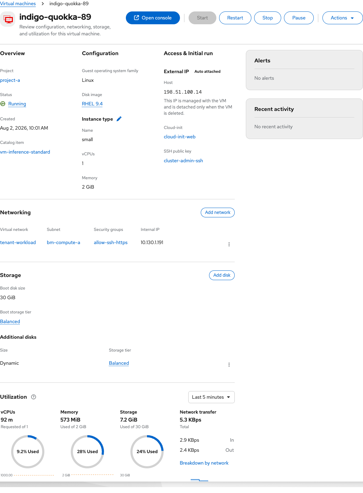
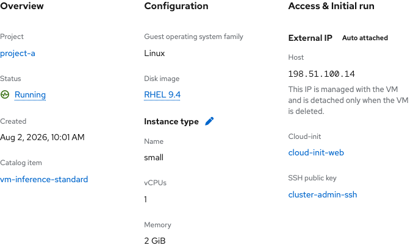
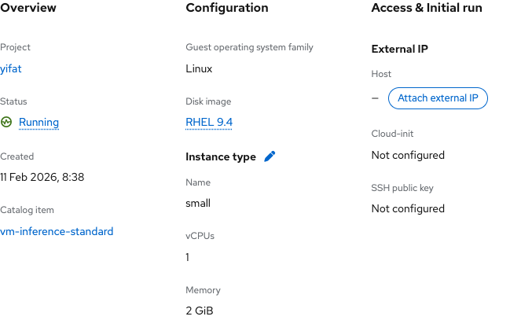
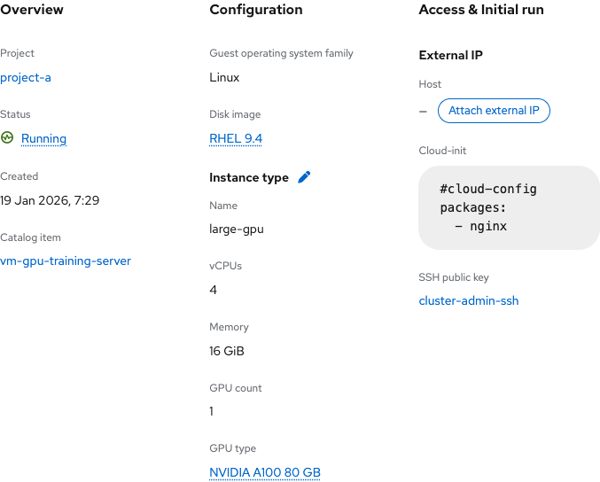
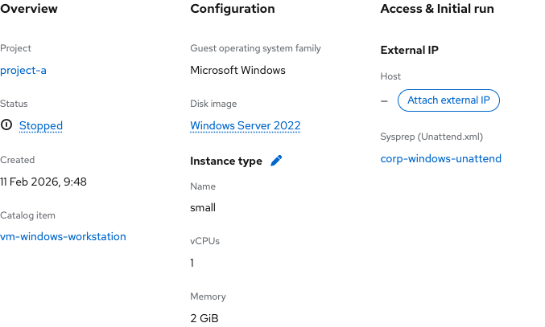
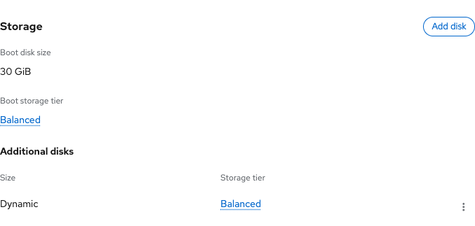

# VM Overview

Contact: Yifat Friman Menchik, UXD

| Handoff field | Current reference |
| --- | --- |
| Jira | [HPUX-2173 — Design VM Overview page](https://redhat.atlassian.net/browse/HPUX-2173) |
| Parent epic | [HPUX-2032 — VM Overview page](https://redhat.atlassian.net/browse/HPUX-2032) |
| Feature | VMaaS virtual machine details and day-2 management |
| Scope | Single-VM Overview, access, network, storage, utilization, and day-2 actions |
| Role | Tenant Admin; Tenant User (limited edits) |
| Interactive mock | [Current VM Overview mockup](https://yfrimanm.github.io/openshift-origin-design/vmaas-ux-prototype.html?v=de6322d&role=admin&vm=indigo-quokka-89) |
| Handoff Google Doc | [VM Overview UX document](https://docs.google.com/document/d/1Y8hjgE924owve0VXA3rkKqTYuB4sXKif8KhXyFL3hyQ/edit) |
| MD handoff | This file |

This handoff documents the day-2 Virtual machine Overview for Tenant Admins and Tenant Users. The interactive mockup is the visual reference. The page brings together status, configuration, access, networking, storage, and utilization; available actions depend on VM state and role.

## Page structure

The header shows the VM name, breadcrumb, **Open console**, state-dependent **Start**, **Restart**, **Stop**, and **Pause** buttons, plus an **Actions** menu. The first content row has **Overview**, **Configuration**, and **Access & Initial run** columns. Alerts and Recent activity appear alongside. Networking, Storage, and Utilization follow below.

## Overview and configuration

Overview shows Project, Status, Created, and Catalog item. Status opens its detail popover. Configuration shows guest operating system family, disk image, and Instance type with its name, vCPUs, memory, and GPU details when applicable. The Instance type edit control opens the resize flow; availability depends on the VM state and permissions.

## Access and initial run

The order is **External IP → Cloud-init or Sysprep → SSH public key** for Linux. Windows shows **Sysprep (Unattend.xml)** instead of Cloud-init and does not show an SSH public key. There is no SSH command in the UI.

An **Auto attached** label appears next to External IP when the IP was attached automatically. The host is visible, but Edit and Detach are not offered. The explanation says the IP is managed with the VM and is detached only when the VM is deleted.

With no external IP, **Attach external IP** is a secondary button beside the empty Host value. A manually attached IP uses a matching **Detach external IP** button. While attachment is in progress, the page shows an attaching state; on failure it shows the error and matching **Retry** and **Choose another** buttons. The [Tenant Networking UX doc](https://docs.google.com/document/d/1Bb-TzaXkhdASe6btymwRk2u0wXycwyqS-I8h637hDGY/edit) owns the full IP interaction.

Cloud-init and Sysprep display a linked secret name when sourced from a secret, a read-only text box when entered inline, and **Not configured** when absent. The SSH public key displays its linked secret name or **Not configured**. No secret content is exposed on the Overview page.

For Windows, Sysprep replaces the Linux Cloud-init and SSH fields.

## Networking and storage

Networking is a table of Virtual network, Subnet, Security groups, and Internal IP, with an **Add network** button and row actions where editing is allowed. Storage separates **Boot disk size** and **Boot storage tier** from **Additional disks**. The additional-disks table has **Size** and **Storage tier** columns plus row actions; it has no disk-name column. **Add disk** is a button. The boot disk is not offered as a deletable additional-disk row.

## Utilization and permissions

A running VM shows vCPU, memory, storage, and network-transfer utilization with a time-range control. A stopped VM shows that utilization is unavailable. Tenant Admins can edit applicable configuration; Tenant Users see read-only configuration except the permitted Instance type resize path. Power and console controls remain governed by VM state and role.

## Related handoffs

- [Create Virtual machine UX document](https://docs.google.com/document/d/1LL0iWhIIh3gAhJAsm7MCpnlFxfzaOXkZS_MVI6dSfSo/edit)
- [Catalog items UX document](https://docs.google.com/document/d/1YTm2X4nUXWVI_Mjq_hXEY4Rj6i9BaOiXjzVeF3jcMA4/edit)
